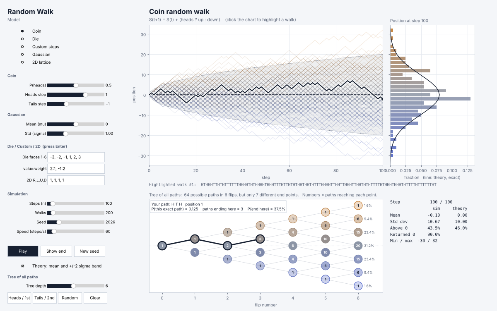

# Random Walk Simulator

An interactive, customizable random walk simulator in Python (NumPy + Matplotlib).

The first example is a coin: **heads moves one step up, tails one step down**. The window shows

- many sample paths, animated step by step, with the theoretical mean and a ±2σ band,
- the distribution of positions at the current step, compared with the exact theoretical distribution,
- the **tree of all possible paths** for the first few flips (Pascal's triangle for a fair coin). You can flip the coin yourself and follow your path through the tree.



## Models

| Model | What one step is |
|---|---|
| Coin | `+up` with probability `p`, `down` otherwise |
| Die | one of six step values, one per face |
| Custom steps | any list of `value:weight`, e.g. `2:1, -1:2` |
| Gaussian | a normal random number `N(mu, sigma²)` |
| 2D lattice | right / left / up / down with adjustable weights |

## Run from source

```bash
pip install -r requirements.txt
python random_walk.py
```

Command-line options set the starting state:

```bash
python random_walk.py --model die --steps 300 --walks 500
python random_walk.py --p 0.55 --seed 7
python random_walk.py --model custom --custom "3:1, -1:3"
python random_walk.py --save walk.png      # save a picture and exit, no window
```

### Controls

- **Model** radio buttons switch between models.
- Sliders change `P(heads)`, step sizes, Gaussian parameters, number of steps, number of walks, the random seed and the animation speed.
- Text boxes (press Enter) set the die faces, custom steps and 2D weights.
- **Play / Show end / New seed** control the animation.
- Click the path chart to highlight a single walk and see its sequence of flips.
- **Heads / Tails / Random / Clear** walk through the tree of all paths.

## Windows executable

Every push to `main` builds `RandomWalk.exe` with GitHub Actions. Download it from the latest run of
**Actions → Build Windows exe → Artifacts → RandomWalk-windows**.
Pushing a tag such as `v1.0` also attaches the exe to a GitHub release.

To build it on your own Windows machine, run `build_exe.bat`. It creates a clean virtual environment in `.venv` (so other packages in your global Python are not bundled) and writes `dist\RandomWalk.exe`.

## Add your own model

Subclass `Model` in `random_walk.py` and register it in `MODELS`. A discrete model only returns its outcomes;
paths, histogram, exact theory and the tree are built automatically.

```python
class BiasedCoinModel(Model):
    name = "Biased coin, step 2"
    rule = "S(t+1) = S(t) + 2 or -1"

    def outcomes(self, s):
        return [Outcome(+2, s.p, "H"), Outcome(-1, 1 - s.p, "T")]

MODELS["biased"] = BiasedCoinModel()
```

For a continuous model, override `sample()` and `moments()` as `GaussianModel` does.
